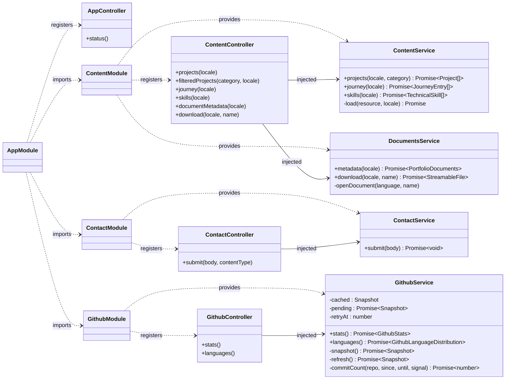
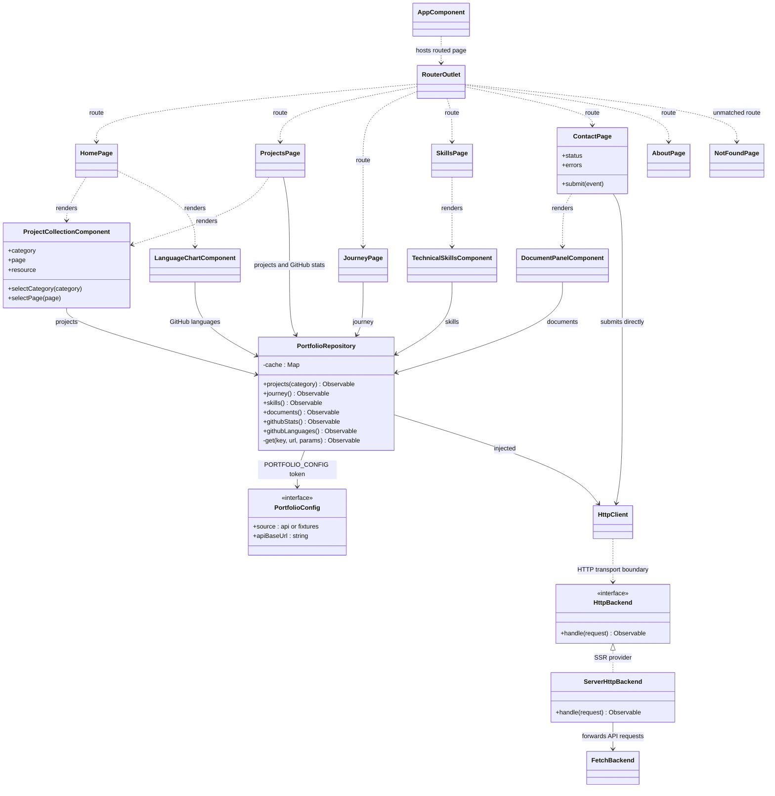
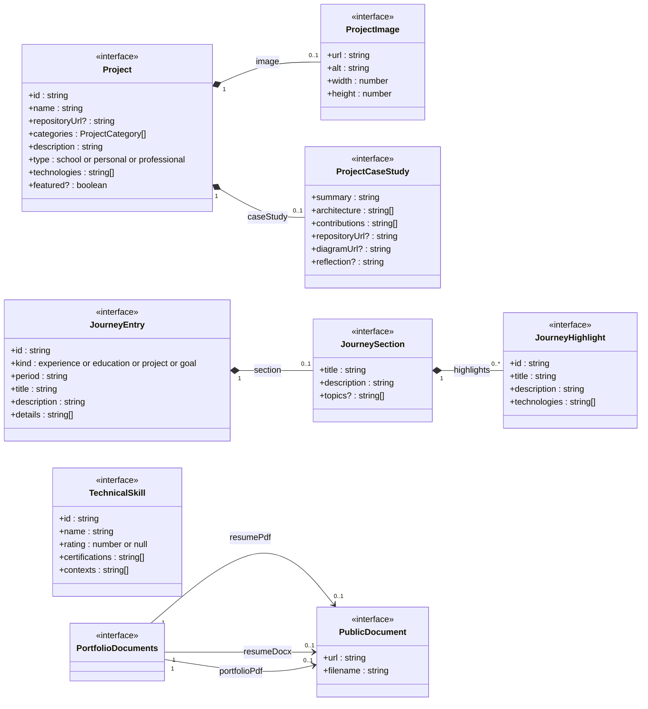
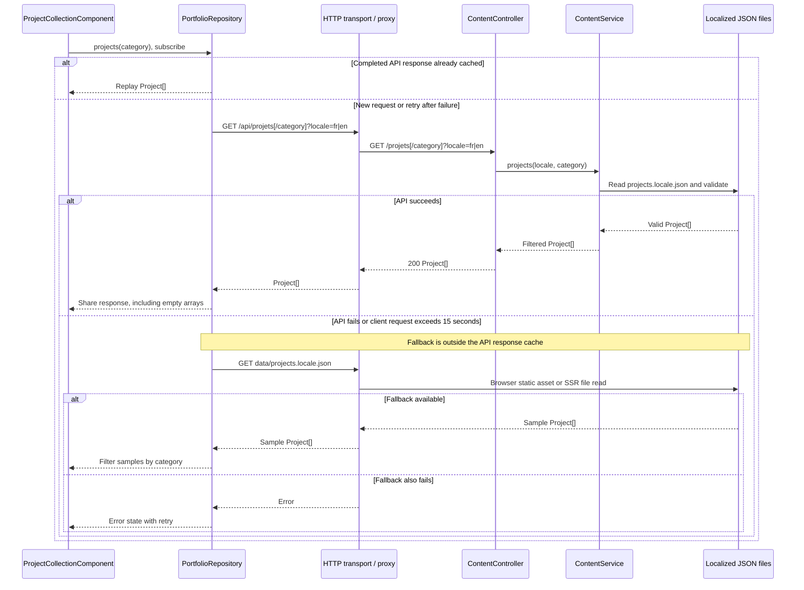
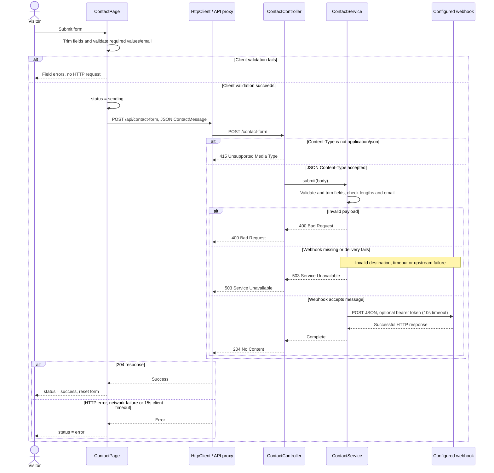
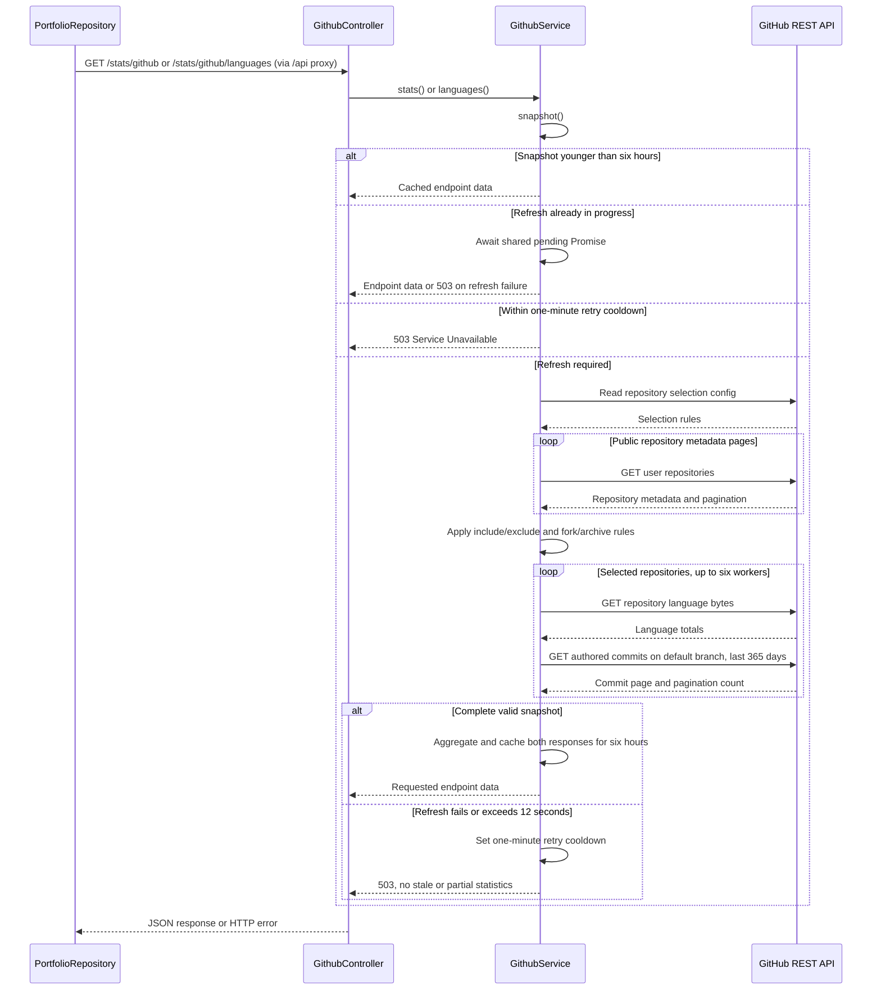
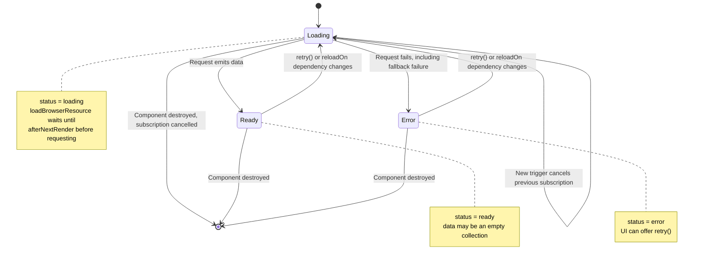
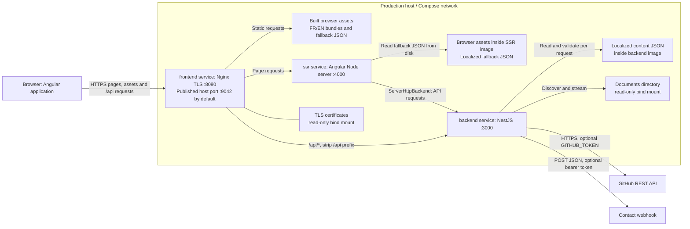

# Repository UML diagrams

These diagrams describe the current implementation in `frontend/src`,
`backend/src`, and `compose.production.yaml`. Open this file on GitHub or in a
Markdown viewer with Mermaid support to see the graphs. Standalone SVG copies
are linked below. Edit the Mermaid blocks to update the sources, then regenerate
the SVG copies with Mermaid CLI; no application dependency is required.

The views focus on application classes, contracts, and important runtime paths.
Framework internals and incidental members are omitted. Dashed class arrows are
dependencies; solid arrows are associations. TypeScript interfaces are marked
`interface`; they are data contracts, not database entities. The frontend and
backend declare corresponding contracts separately rather than importing one
shared package. Optional members are marked `?`, and `readonly` is omitted for
readability.

| Diagram source | Standalone image |
| --- | --- |
| [Backend classes](#backend-classes) | [SVG](uml/backend-classes.svg) |
| [Frontend classes](#frontend-classes) | [SVG](uml/frontend-classes.svg) |
| [Content contracts](#content-contracts) | [SVG](uml/content-contracts.svg) |
| [Project loading sequence](#project-loading-sequence) | [SVG](uml/project-loading-sequence.svg) |
| [Contact submission sequence](#contact-submission-sequence) | [SVG](uml/contact-submission-sequence.svg) |
| [GitHub statistics sequence](#github-statistics-sequence) | [SVG](uml/github-statistics-sequence.svg) |
| [Resource loading states](#resource-loading-states) | [SVG](uml/resource-loading-states.svg) |
| [Production deployment overview](#production-deployment-overview) | [SVG](uml/production-deployment-overview.svg) |

## Backend classes

Sources: [application module](../backend/src/app.module.ts),
[content](../backend/src/content/), [contact](../backend/src/contact/),
and [GitHub](../backend/src/github/).

`ContentService` reads and validates localized JSON on every request.
`DocumentsService` discovers and streams files from disk. `ContactService`
validates with the `contactMessage` function and forwards to a configured
webhook. `GithubService` fetches GitHub data and keeps a shared in-memory snapshot.
There is no database in this implementation.

## Frontend classes

Sources: [routes](../frontend/src/app/app.routes.ts),
[pages](../frontend/src/app/pages/), [shared components](../frontend/src/app/shared/),
[repository](../frontend/src/app/core/portfolio.repository.ts), and
[SSR HTTP transport](../frontend/src/app/core/server-http-backend.ts).

Route components are lazy loaded. `loadResource` is a function used by the
data-consuming components, not an injected service. Contact submissions bypass
`PortfolioRepository`. On SSR, `ServerHttpBackend` rewrites `/api/` URLs to the
backend and reads supported fallback JSON requests from disk; the browser uses
the normal HTTP transport. Angular hydration can reuse server HTTP responses.

## Content contracts

Sources: [project contract](../frontend/src/app/core/project.contract.ts),
[journey contract](../frontend/src/app/core/journey.contract.ts),
[portfolio models](../frontend/src/app/core/portfolio.models.ts), and
[backend content types](../backend/src/content/content.types.ts).

Composition here represents nested JSON values. Missing document slots are
explicitly `null`; optional project/journey members may be absent. Project
categories are `fullstack`, `relative-low-level`, `low-level`, `backend`,
`frontend`, `devops`, and `ai`; one project may belong to several categories.

## Project loading sequence

Sources: [project collection](../frontend/src/app/shared/project-collection.component.ts),
[repository](../frontend/src/app/core/portfolio.repository.ts),
[content controller](../backend/src/content/content.controller.ts), and
[content service](../backend/src/content/content.service.ts).

Concurrent consumers share the request for the same cache key. A successful
empty API response stays empty. A later subscription after API failure retries
the API, even if fallback data was available. Journey has the same API-first
fallback policy; skills and documents instead follow the explicit configured
source, and GitHub statistics have no fixture fallback.

## Contact submission sequence

Sources: [contact page](../frontend/src/app/pages/contact.page.ts),
[controller](../backend/src/contact/contact.controller.ts), and
[service and validation](../backend/src/contact/contact.service.ts).

`ContactMessage` contains `name`, `email`, `subject`, and `message`. Messages are
not stored locally or automatically retried. A client timeout does not prove
that the receiver failed to accept a message.

## GitHub statistics sequence

Sources: [GitHub service](../backend/src/github/github.service.ts),
[selection and aggregation functions](../backend/src/github/github.data.ts),
and [response types](../backend/src/github/github.types.ts).

The refresh has a 12-second overall deadline and individual GitHub fetches have
a 5-second timeout. The cache is shared by both endpoints within one API process;
it is not a shared external cache. Browser HTTP paths have the `/api` prefix,
which is removed before NestJS handles them.

## Resource loading states

Sources: [`LoadState`](../frontend/src/app/core/portfolio.models.ts) and
[`loadResource` / `loadBrowserResource`](../frontend/src/app/core/load-resource.ts).

The status values in code are lowercase: `loading`, `ready`, and `error`.
The initial state is loading; `loadBrowserResource` suppresses requests during
SSR and starts them after browser rendering. A successful fallback produces
the ready state.

## Production deployment overview

This supplementary architecture view uses a Mermaid flowchart rather than
formal UML deployment notation. It follows
[production Compose](../compose.production.yaml),
[Nginx routing](../frontend/nginx/routes.conf), and
[the Angular server](../frontend/src/server.ts).

Only Nginx publishes a host port in production Compose. SSR and NestJS are
reached over the internal Compose network. The Node SSR server also supports
an `/api/` proxy for standalone previews; production Nginx sends browser API
requests directly to NestJS. The SSR image contains its own browser assets for
fallback reads, separate from Nginx's copy.
