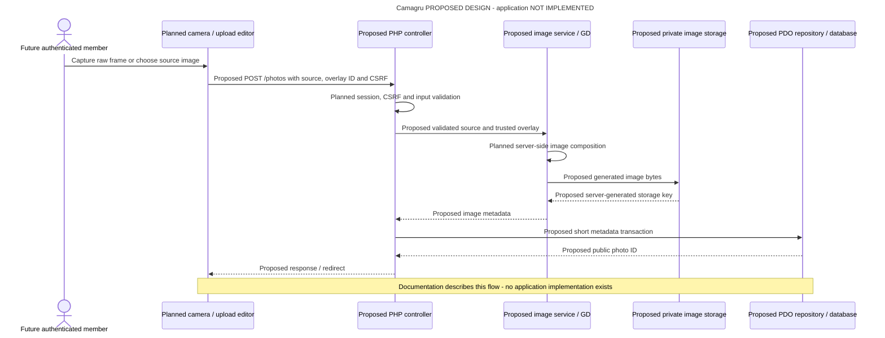

# 42camagru: UML

Reviewed source: [3bbd080f9227](https://github.com/ErwanLucienMMV/42camagru/tree/3bbd080f92278262038125a5b74a06263850e841).

DOCUMENTATION ONLY: the reviewed repository explicitly says the application has not been implemented. The UML below is a proposed sequence distilled from its architecture and image-processing guides, not a reverse-engineered runtime. Proposed controllers, services, repositories, storage paths and routes do not yet exist as application files. The diagram is labeled as unimplemented so the portfolio does not present the guide as a working product.

[Open SVG](../../../backend/src/content/diagrams/42camagru.svg).
Portfolio: `/fr/projets?project=42camagru` and `/en/projects?project=42camagru`.
API: `/api/diagrams/42camagru.svg`.

Inspected implementation files:

- [README.md](https://github.com/ErwanLucienMMV/42camagru/blob/3bbd080f92278262038125a5b74a06263850e841/README.md)
- [docs/05-architecture-and-routes.md](https://github.com/ErwanLucienMMV/42camagru/blob/3bbd080f92278262038125a5b74a06263850e841/docs/05-architecture-and-routes.md)
- [docs/06-database-and-pdo.md](https://github.com/ErwanLucienMMV/42camagru/blob/3bbd080f92278262038125a5b74a06263850e841/docs/06-database-and-pdo.md)
- [docs/08-camera-and-image-editing.md](https://github.com/ErwanLucienMMV/42camagru/blob/3bbd080f92278262038125a5b74a06263850e841/docs/08-camera-and-image-editing.md)
