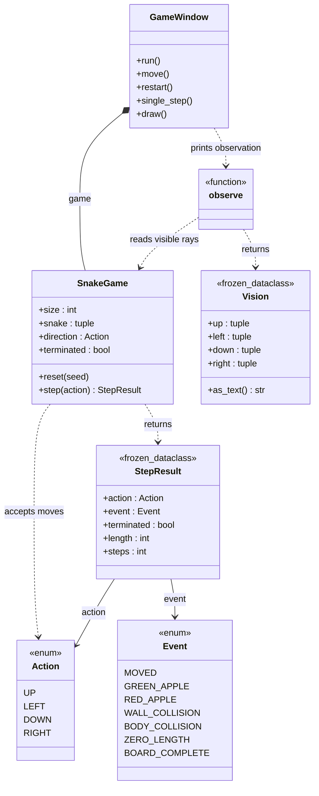

# 42Learn2Slither: UML

Reviewed source: [768a9bfe97b9](https://github.com/ErwanLucienMMV/42Learn2Slither/tree/768a9bfe97b9f92b3c708ef355a3a81c782833db).

UML of the implemented manual Snake environment. GameWindow owns SnakeGame and uses the observe function for four-ray Vision. SnakeGame.step returns facts in StepResult; reward calculation, agents, Q-learning, neural networks, training and model persistence are explicitly not implemented in the reviewed README/code and are not drawn as existing classes. The environment is display-independent and the Pygame window is optional through --play.

[Open SVG](../../../backend/src/content/diagrams/42learn2slither.svg).
Portfolio: `/fr/projets?project=42learn2slither` and `/en/projects?project=42learn2slither`.
API: `/api/diagrams/42learn2slither.svg`.

Inspected implementation files:

- [slither/environment.py](https://github.com/ErwanLucienMMV/42Learn2Slither/blob/768a9bfe97b9f92b3c708ef355a3a81c782833db/slither/environment.py)
- [slither/vision.py](https://github.com/ErwanLucienMMV/42Learn2Slither/blob/768a9bfe97b9f92b3c708ef355a3a81c782833db/slither/vision.py)
- [slither/display.py](https://github.com/ErwanLucienMMV/42Learn2Slither/blob/768a9bfe97b9f92b3c708ef355a3a81c782833db/slither/display.py)
- [slither/cli.py](https://github.com/ErwanLucienMMV/42Learn2Slither/blob/768a9bfe97b9f92b3c708ef355a3a81c782833db/slither/cli.py)
- [README.md](https://github.com/ErwanLucienMMV/42Learn2Slither/blob/768a9bfe97b9f92b3c708ef355a3a81c782833db/README.md)
