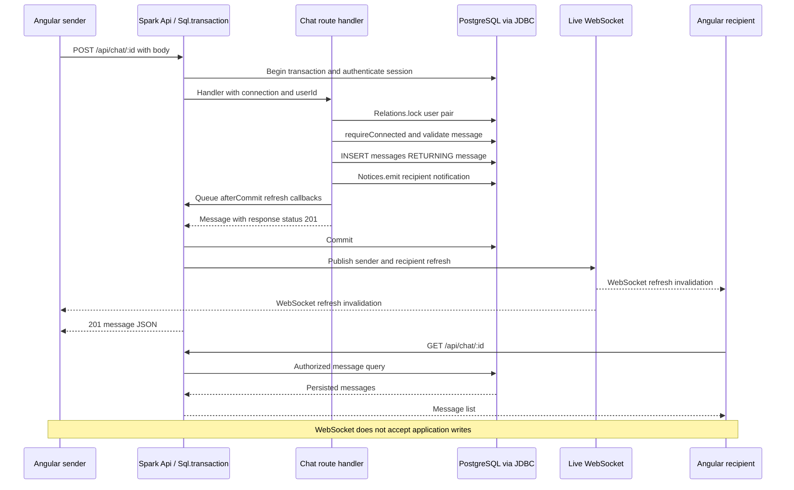

# 42matcha: UML

Reviewed source: [0f64f0d092a6](https://github.com/ErwanLucienMMV/42matcha/tree/0f64f0d092a656dfd0229628e8c7cfba474730d5).

UML sequence of an implemented successful chat send. Spark Java Api wraps handlers in explicit JDBC transactions backed by Database/HikariCP and PostgreSQL. Relations locks the user pair and requires a mutual, unblocked connection. Application writes use authenticated HTTP: Live WebSocket sends refresh invalidations and heartbeat messages rather than carrying chat writes. Notices and sender refresh callbacks run after commit, and Angular reloads messages over HTTP. Other account, search, photo and discovery routes are omitted.

[Open SVG](../../../backend/src/content/diagrams/42matcha.svg).
Portfolio: `/fr/projets?project=42matcha` and `/en/projects?project=42matcha`.
API: `/api/diagrams/42matcha.svg`.

Inspected implementation files:

- [backend/src/main/java/dev/matcha/App.java](https://github.com/ErwanLucienMMV/42matcha/blob/0f64f0d092a656dfd0229628e8c7cfba474730d5/backend/src/main/java/dev/matcha/App.java)
- [backend/src/main/java/dev/matcha/Api.java](https://github.com/ErwanLucienMMV/42matcha/blob/0f64f0d092a656dfd0229628e8c7cfba474730d5/backend/src/main/java/dev/matcha/Api.java)
- [backend/src/main/java/dev/matcha/Chat.java](https://github.com/ErwanLucienMMV/42matcha/blob/0f64f0d092a656dfd0229628e8c7cfba474730d5/backend/src/main/java/dev/matcha/Chat.java)
- [backend/src/main/java/dev/matcha/Relations.java](https://github.com/ErwanLucienMMV/42matcha/blob/0f64f0d092a656dfd0229628e8c7cfba474730d5/backend/src/main/java/dev/matcha/Relations.java)
- [backend/src/main/java/dev/matcha/Notices.java](https://github.com/ErwanLucienMMV/42matcha/blob/0f64f0d092a656dfd0229628e8c7cfba474730d5/backend/src/main/java/dev/matcha/Notices.java)
- [backend/src/main/java/dev/matcha/Sql.java](https://github.com/ErwanLucienMMV/42matcha/blob/0f64f0d092a656dfd0229628e8c7cfba474730d5/backend/src/main/java/dev/matcha/Sql.java)
- [backend/src/main/java/dev/matcha/Database.java](https://github.com/ErwanLucienMMV/42matcha/blob/0f64f0d092a656dfd0229628e8c7cfba474730d5/backend/src/main/java/dev/matcha/Database.java)
- [backend/src/main/java/dev/matcha/Live.java](https://github.com/ErwanLucienMMV/42matcha/blob/0f64f0d092a656dfd0229628e8c7cfba474730d5/backend/src/main/java/dev/matcha/Live.java)
- [frontend/src/app/live.ts](https://github.com/ErwanLucienMMV/42matcha/blob/0f64f0d092a656dfd0229628e8c7cfba474730d5/frontend/src/app/live.ts)
- [frontend/src/app/messages-page.ts](https://github.com/ErwanLucienMMV/42matcha/blob/0f64f0d092a656dfd0229628e8c7cfba474730d5/frontend/src/app/messages-page.ts)
- [compose.yaml](https://github.com/ErwanLucienMMV/42matcha/blob/0f64f0d092a656dfd0229628e8c7cfba474730d5/compose.yaml)
