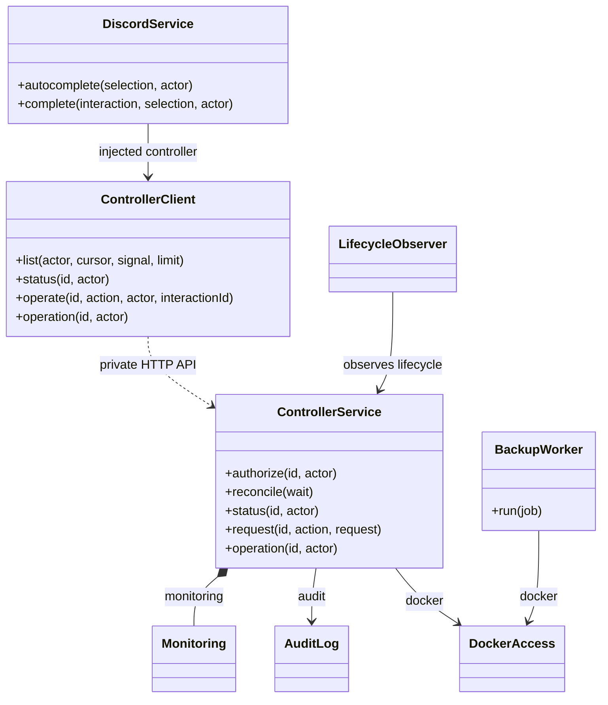

# AtlasDominion: UML

Reviewed source: [89759e7a5d4a](https://github.com/ErwanLucienMMV/AtlasDominion/tree/89759e7a5d4ae8b730ed565ecedb31ddaefea3b5).

Class view of implemented Discord command dispatch and Docker orchestration. HTTP adapters connect separate processes; the dashed HTTP dependency is not an in-process object reference. Registry and lock helpers are functions, not invented services. The backup worker operates on verified stopped volumes. Infrastructure additionally provisions Traefik, Prometheus and Grafana; those deployment services are outside this class view.

[Open SVG](../../../backend/src/content/diagrams/atlas-dominion.svg).
Portfolio: `/fr/projets?project=atlas-dominion` and `/en/projects?project=atlas-dominion`.
API: `/api/diagrams/atlas-dominion.svg`.

Inspected implementation files:

- [apps/discord-api/service.mjs](https://github.com/ErwanLucienMMV/AtlasDominion/blob/89759e7a5d4ae8b730ed565ecedb31ddaefea3b5/apps/discord-api/service.mjs)
- [apps/discord-api/controller.mjs](https://github.com/ErwanLucienMMV/AtlasDominion/blob/89759e7a5d4ae8b730ed565ecedb31ddaefea3b5/apps/discord-api/controller.mjs)
- [apps/docker-controller/main.mjs](https://github.com/ErwanLucienMMV/AtlasDominion/blob/89759e7a5d4ae8b730ed565ecedb31ddaefea3b5/apps/docker-controller/main.mjs)
- [apps/docker-controller/service.mjs](https://github.com/ErwanLucienMMV/AtlasDominion/blob/89759e7a5d4ae8b730ed565ecedb31ddaefea3b5/apps/docker-controller/service.mjs)
- [apps/docker-controller/docker.mjs](https://github.com/ErwanLucienMMV/AtlasDominion/blob/89759e7a5d4ae8b730ed565ecedb31ddaefea3b5/apps/docker-controller/docker.mjs)
- [apps/docker-controller/monitoring.mjs](https://github.com/ErwanLucienMMV/AtlasDominion/blob/89759e7a5d4ae8b730ed565ecedb31ddaefea3b5/apps/docker-controller/monitoring.mjs)
- [apps/docker-controller/audit.mjs](https://github.com/ErwanLucienMMV/AtlasDominion/blob/89759e7a5d4ae8b730ed565ecedb31ddaefea3b5/apps/docker-controller/audit.mjs)
- [apps/backup-worker/worker.mjs](https://github.com/ErwanLucienMMV/AtlasDominion/blob/89759e7a5d4ae8b730ed565ecedb31ddaefea3b5/apps/backup-worker/worker.mjs)
