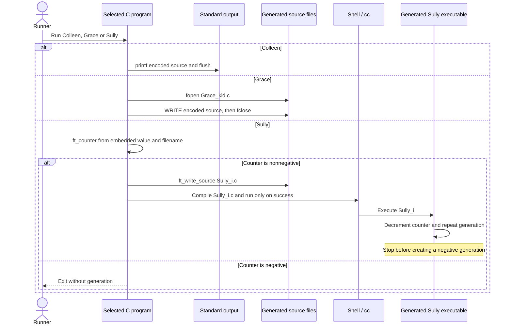

# DrQuinn: UML

Reviewed source: [0fe8a81a65dc](https://github.com/ErwanLucienMMV/DrQuinn/tree/0fe8a81a65dc6a1411c31d131457bb51b3e87131).

UML sequence of the C implementations of Colleen, Grace and Sully. These are independent programs, not a class hierarchy. They expand encoded source text rather than reading their source files. Sully's original counter is five; generated programs decrement it and stop before writing a negative generation. Assembly and Python variants are also present; the diagram shows the C compiler path, not the Python bytecode or NASM paths. No cloned program was executed during this review.

[Open SVG](../../../backend/src/content/diagrams/dr-quinn.svg).
Portfolio: `/fr/projets?project=dr-quinn` and `/en/projects?project=dr-quinn`.
API: `/api/diagrams/dr-quinn.svg`.

Inspected implementation files:

- [C/Colleen.c](https://github.com/ErwanLucienMMV/DrQuinn/blob/0fe8a81a65dc6a1411c31d131457bb51b3e87131/C/Colleen.c)
- [C/Grace.c](https://github.com/ErwanLucienMMV/DrQuinn/blob/0fe8a81a65dc6a1411c31d131457bb51b3e87131/C/Grace.c)
- [C/Sully.c](https://github.com/ErwanLucienMMV/DrQuinn/blob/0fe8a81a65dc6a1411c31d131457bb51b3e87131/C/Sully.c)
- [C/Makefile](https://github.com/ErwanLucienMMV/DrQuinn/blob/0fe8a81a65dc6a1411c31d131457bb51b3e87131/C/Makefile)
- [ASM/Sully.s](https://github.com/ErwanLucienMMV/DrQuinn/blob/0fe8a81a65dc6a1411c31d131457bb51b3e87131/ASM/Sully.s)
- [Python/Sully.py](https://github.com/ErwanLucienMMV/DrQuinn/blob/0fe8a81a65dc6a1411c31d131457bb51b3e87131/Python/Sully.py)
