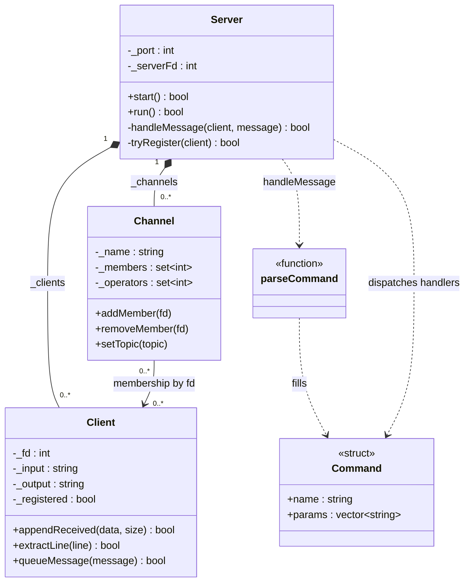

# ft_irc: UML

Reviewed source: [62d7ee80b5e2](https://github.com/ErwanLucienMMV/ft_irc/tree/62d7ee80b5e23a721aebd849efd488b2183bd836).

C++98 classes and the actual Command struct. Server owns Client and Channel values in maps and closes their sockets. Channel membership stores file descriptors, not owned Client objects. parseCommand is a free function, shown as a function stereotype rather than an invented Parser class. Socket readiness is multiplexed with select in Server.

[Open SVG](../../../backend/src/content/diagrams/ft-irc.svg).
Portfolio: `/fr/projets?project=ft-irc` and `/en/projects?project=ft-irc`.
API: `/api/diagrams/ft-irc.svg`.

Inspected implementation files:

- [includes/server.hpp](https://github.com/ErwanLucienMMV/ft_irc/blob/62d7ee80b5e23a721aebd849efd488b2183bd836/includes/server.hpp)
- [includes/client.hpp](https://github.com/ErwanLucienMMV/ft_irc/blob/62d7ee80b5e23a721aebd849efd488b2183bd836/includes/client.hpp)
- [includes/channel.hpp](https://github.com/ErwanLucienMMV/ft_irc/blob/62d7ee80b5e23a721aebd849efd488b2183bd836/includes/channel.hpp)
- [includes/parser.hpp](https://github.com/ErwanLucienMMV/ft_irc/blob/62d7ee80b5e23a721aebd849efd488b2183bd836/includes/parser.hpp)
- [srcs/main.cpp](https://github.com/ErwanLucienMMV/ft_irc/blob/62d7ee80b5e23a721aebd849efd488b2183bd836/srcs/main.cpp)
- [srcs/server.cpp](https://github.com/ErwanLucienMMV/ft_irc/blob/62d7ee80b5e23a721aebd849efd488b2183bd836/srcs/server.cpp)
- [srcs/parser.cpp](https://github.com/ErwanLucienMMV/ft_irc/blob/62d7ee80b5e23a721aebd849efd488b2183bd836/srcs/parser.cpp)
