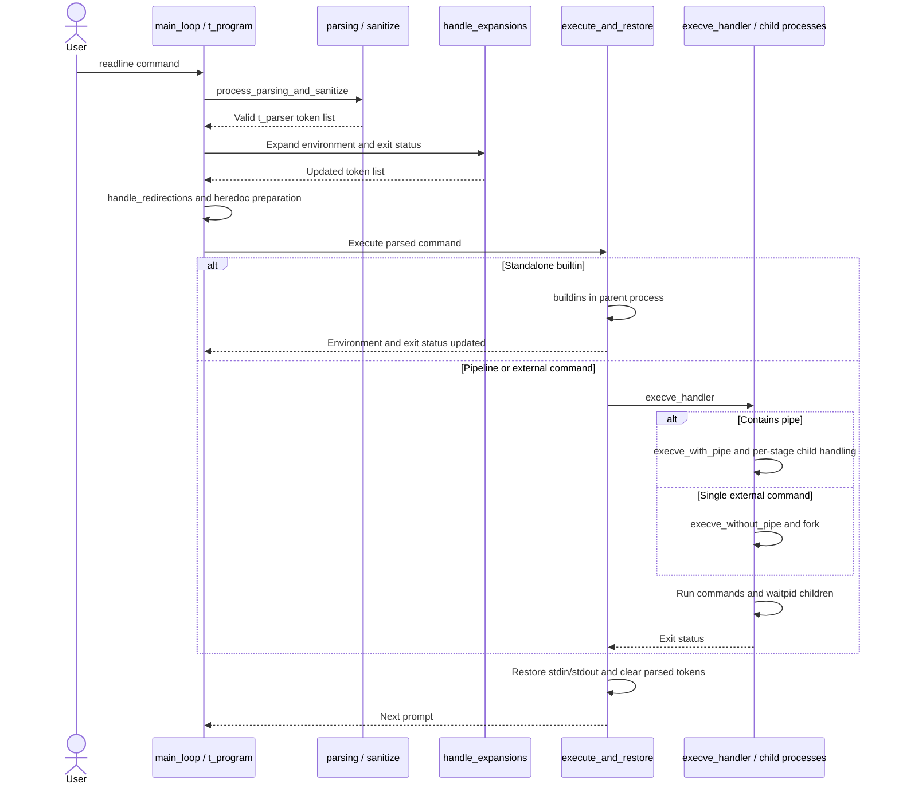

# ft_minishell: UML

Reviewed source: [1961154719a4](https://github.com/ErwanLucienMMV/ft_minishell/tree/1961154719a49796f5163a5e7f658e16ac0b362b).

UML sequence for a successful interactive iteration in the C implementation. Lifelines are function groups and OS processes, not invented classes. The parsed command stream is a doubly linked t_parser list; t_program retains environment and exit status. Standalone builtins run in the parent so environment changes survive. Pipelines are executed through the fork/pipe path. Error exits, heredoc interrupts and signal details are omitted from this focused view.

[Open SVG](../../../backend/src/content/diagrams/ft-minishell.svg).
Portfolio: `/fr/projets?project=ft-minishell` and `/en/projects?project=ft-minishell`.
API: `/api/diagrams/ft-minishell.svg`.

Inspected implementation files:

- [terminal/program.h](https://github.com/ErwanLucienMMV/ft_minishell/blob/1961154719a49796f5163a5e7f658e16ac0b362b/terminal/program.h)
- [terminal/terminal.c](https://github.com/ErwanLucienMMV/ft_minishell/blob/1961154719a49796f5163a5e7f658e16ac0b362b/terminal/terminal.c)
- [terminal/terminal_utils_handlers.c](https://github.com/ErwanLucienMMV/ft_minishell/blob/1961154719a49796f5163a5e7f658e16ac0b362b/terminal/terminal_utils_handlers.c)
- [parser/parser.h](https://github.com/ErwanLucienMMV/ft_minishell/blob/1961154719a49796f5163a5e7f658e16ac0b362b/parser/parser.h)
- [envpath/envpath.h](https://github.com/ErwanLucienMMV/ft_minishell/blob/1961154719a49796f5163a5e7f658e16ac0b362b/envpath/envpath.h)
- [execve/execve.h](https://github.com/ErwanLucienMMV/ft_minishell/blob/1961154719a49796f5163a5e7f658e16ac0b362b/execve/execve.h)
- [execve/execve.c](https://github.com/ErwanLucienMMV/ft_minishell/blob/1961154719a49796f5163a5e7f658e16ac0b362b/execve/execve.c)
- [execve/execve_without_pipe.c](https://github.com/ErwanLucienMMV/ft_minishell/blob/1961154719a49796f5163a5e7f658e16ac0b362b/execve/execve_without_pipe.c)
- [execve/execve_piped.c](https://github.com/ErwanLucienMMV/ft_minishell/blob/1961154719a49796f5163a5e7f658e16ac0b362b/execve/execve_piped.c)
