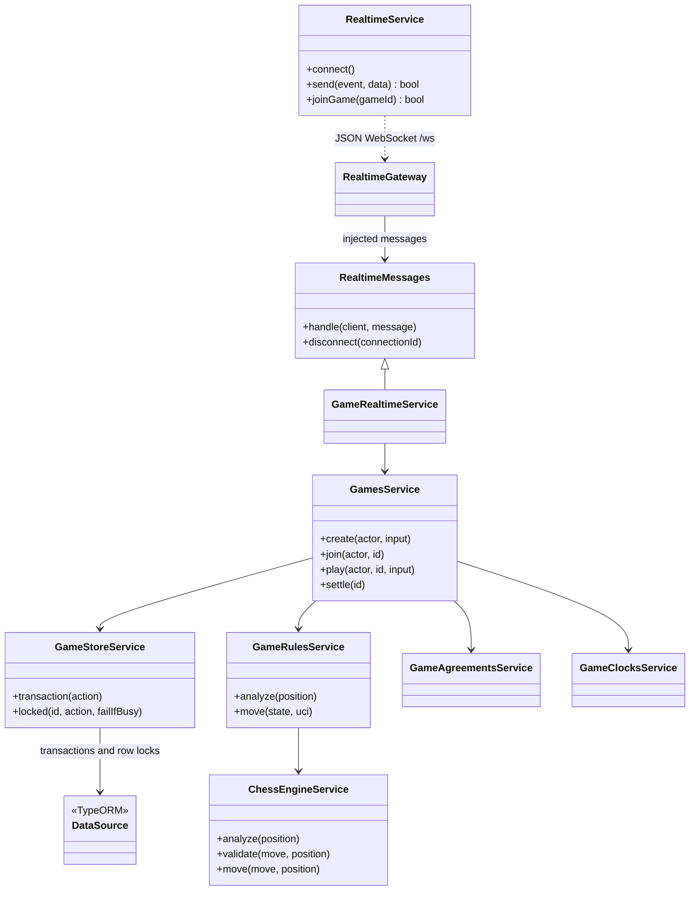

# ft_transcendance: UML

Reviewed source: [e965578eb962](https://github.com/ErwanLucienMMV/ft_transcendance/tree/e965578eb962fd257b69d4c71584dd96a02f54ac).

Focused class view of the implemented chess game and realtime path, not the entire platform. Angular RealtimeService talks to RealtimeGateway over native JSON WebSocket at /ws. GameRealtimeService extends the concrete RealtimeMessages dispatch abstraction. GameRulesService calls a separate chess-engine process through ChessEngineService; GameStoreService persists through TypeORM/PostgreSQL. Authentication, matchmaking, chat, bots, ratings and infrastructure have additional classes omitted for readability.

[Open SVG](../../../backend/src/content/diagrams/ft-transcendance.svg).
Portfolio: `/fr/projets?project=ft-transcendance` and `/en/projects?project=ft-transcendance`.
API: `/api/diagrams/ft-transcendance.svg`.

Inspected implementation files:

- [srcs/angular/42chess/src/app/core/realtime/realtime.service.ts](https://github.com/ErwanLucienMMV/ft_transcendance/blob/e965578eb962fd257b69d4c71584dd96a02f54ac/srcs/angular/42chess/src/app/core/realtime/realtime.service.ts)
- [srcs/nestJS/42chess/src/realtime/realtime.gateway.ts](https://github.com/ErwanLucienMMV/ft_transcendance/blob/e965578eb962fd257b69d4c71584dd96a02f54ac/srcs/nestJS/42chess/src/realtime/realtime.gateway.ts)
- [srcs/nestJS/42chess/src/realtime/realtime-messages.ts](https://github.com/ErwanLucienMMV/ft_transcendance/blob/e965578eb962fd257b69d4c71584dd96a02f54ac/srcs/nestJS/42chess/src/realtime/realtime-messages.ts)
- [srcs/nestJS/42chess/src/realtime/game-realtime.service.ts](https://github.com/ErwanLucienMMV/ft_transcendance/blob/e965578eb962fd257b69d4c71584dd96a02f54ac/srcs/nestJS/42chess/src/realtime/game-realtime.service.ts)
- [srcs/nestJS/42chess/src/realtime/realtime.module.ts](https://github.com/ErwanLucienMMV/ft_transcendance/blob/e965578eb962fd257b69d4c71584dd96a02f54ac/srcs/nestJS/42chess/src/realtime/realtime.module.ts)
- [srcs/nestJS/42chess/src/games/games.service.ts](https://github.com/ErwanLucienMMV/ft_transcendance/blob/e965578eb962fd257b69d4c71584dd96a02f54ac/srcs/nestJS/42chess/src/games/games.service.ts)
- [srcs/nestJS/42chess/src/games/games.module.ts](https://github.com/ErwanLucienMMV/ft_transcendance/blob/e965578eb962fd257b69d4c71584dd96a02f54ac/srcs/nestJS/42chess/src/games/games.module.ts)
- [srcs/nestJS/42chess/src/games/game-rules.service.ts](https://github.com/ErwanLucienMMV/ft_transcendance/blob/e965578eb962fd257b69d4c71584dd96a02f54ac/srcs/nestJS/42chess/src/games/game-rules.service.ts)
- [srcs/nestJS/42chess/src/games/game-store.service.ts](https://github.com/ErwanLucienMMV/ft_transcendance/blob/e965578eb962fd257b69d4c71584dd96a02f54ac/srcs/nestJS/42chess/src/games/game-store.service.ts)
- [srcs/nestJS/42chess/src/chess/chess-engine.service.ts](https://github.com/ErwanLucienMMV/ft_transcendance/blob/e965578eb962fd257b69d4c71584dd96a02f54ac/srcs/nestJS/42chess/src/chess/chess-engine.service.ts)
- [srcs/docker-compose.yml](https://github.com/ErwanLucienMMV/ft_transcendance/blob/e965578eb962fd257b69d4c71584dd96a02f54ac/srcs/docker-compose.yml)
