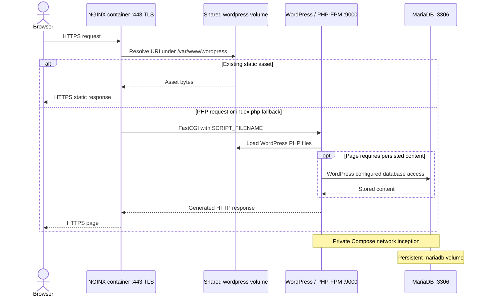

# Inception: UML

Reviewed source: [1747305fbe30](https://github.com/ErwanLucienMMV/Inception/tree/1747305fbe305d8e7841e1db197b57dd658b3d92).

UML sequence of the configured runtime request path. This repository is infrastructure, not an application class library: its startup script downloads WordPress with WP-CLI. The PHP/database exchange represents the configured WordPress dependency rather than a specific SQL query implemented in this repository. NGINX and WordPress share the wordpress volume; MariaDB has its own persistent volume. Only NGINX publishes a host port (443).

[Open SVG](../../../backend/src/content/diagrams/inception.svg).
Portfolio: `/fr/projets?project=inception` and `/en/projects?project=inception`.
API: `/api/diagrams/inception.svg`.

Inspected implementation files:

- [srcs/docker-compose.yml](https://github.com/ErwanLucienMMV/Inception/blob/1747305fbe305d8e7841e1db197b57dd658b3d92/srcs/docker-compose.yml)
- [srcs/requirements/nginx/conf/nginx.conf](https://github.com/ErwanLucienMMV/Inception/blob/1747305fbe305d8e7841e1db197b57dd658b3d92/srcs/requirements/nginx/conf/nginx.conf)
- [srcs/requirements/wordpress/Dockerfile](https://github.com/ErwanLucienMMV/Inception/blob/1747305fbe305d8e7841e1db197b57dd658b3d92/srcs/requirements/wordpress/Dockerfile)
- [srcs/requirements/wordpress/conf/start.sh](https://github.com/ErwanLucienMMV/Inception/blob/1747305fbe305d8e7841e1db197b57dd658b3d92/srcs/requirements/wordpress/conf/start.sh)
- [srcs/requirements/mariadb/conf/start.sh](https://github.com/ErwanLucienMMV/Inception/blob/1747305fbe305d8e7841e1db197b57dd658b3d92/srcs/requirements/mariadb/conf/start.sh)
