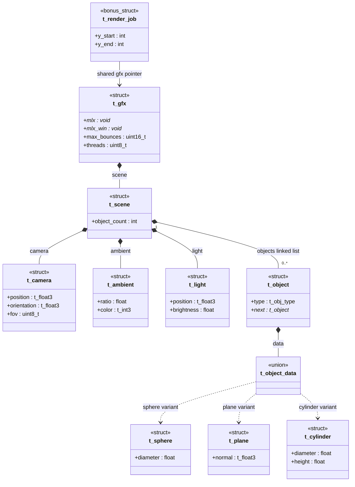

# MiniRT: UML

Reviewed source: [54c7bf80b296](https://github.com/ErwanLucienMMV/minirt/tree/54c7bf80b2962b5a112cdda1b8997889cfe21d15).

UML of actual C scene and renderer structs. Shape variants are members of a tagged union, not subclasses. A scene has one camera, one ambient descriptor, one light and a linked object list in the reviewed code. t_render_job exists only in the MINIRT_BONUS build and refers to shared graphics state; it does not own another scene. Ray-intersection math, GUI types and vector primitives are omitted for readability.

[Open SVG](../../../backend/src/content/diagrams/minirt.svg).
Portfolio: `/fr/projets?project=minirt` and `/en/projects?project=minirt`.
API: `/api/diagrams/minirt.svg`.

Inspected implementation files:

- [include/scene.h](https://github.com/ErwanLucienMMV/minirt/blob/54c7bf80b2962b5a112cdda1b8997889cfe21d15/include/scene.h)
- [include/object.h](https://github.com/ErwanLucienMMV/minirt/blob/54c7bf80b2962b5a112cdda1b8997889cfe21d15/include/object.h)
- [include/gfx.h](https://github.com/ErwanLucienMMV/minirt/blob/54c7bf80b2962b5a112cdda1b8997889cfe21d15/include/gfx.h)
- [include/ray.h](https://github.com/ErwanLucienMMV/minirt/blob/54c7bf80b2962b5a112cdda1b8997889cfe21d15/include/ray.h)
- [include/render.h](https://github.com/ErwanLucienMMV/minirt/blob/54c7bf80b2962b5a112cdda1b8997889cfe21d15/include/render.h)
- [src/main.c](https://github.com/ErwanLucienMMV/minirt/blob/54c7bf80b2962b5a112cdda1b8997889cfe21d15/src/main.c)
- [src/render/rnd_loop_bonus.c](https://github.com/ErwanLucienMMV/minirt/blob/54c7bf80b2962b5a112cdda1b8997889cfe21d15/src/render/rnd_loop_bonus.c)
