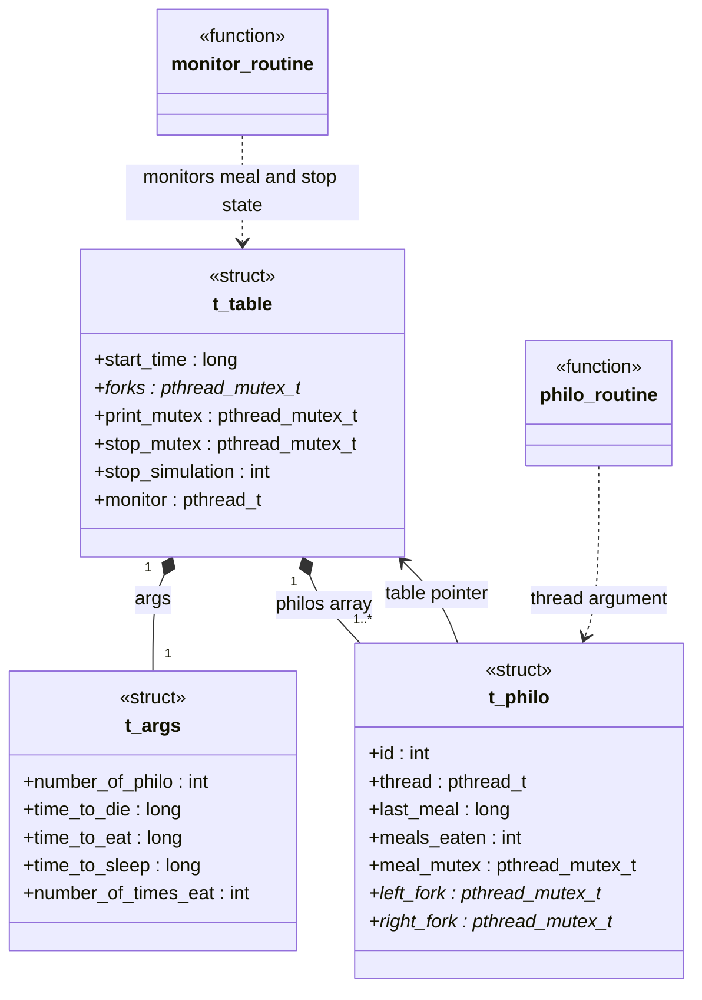

# my_philosopher: UML

Reviewed source: [e00951bc9be6](https://github.com/ErwanLucienMMV/my_philosopher/tree/e00951bc9be6bf49f40381de54d24b3c67168ce3).

Structural UML of C structs, not C++ classes. t_table owns the configuration value, allocated philosophers and fork mutex arrays. Each philosopher refers back to the same table and points at neighboring entries in the shared fork array; its meal_mutex is separate. Thread entry points are explicitly marked as functions. This documents the implementation and does not claim that its synchronization has been formally proved race-free.

[Open SVG](../../../backend/src/content/diagrams/my-philosopher.svg).
Portfolio: `/fr/projets?project=my-philosopher` and `/en/projects?project=my-philosopher`.
API: `/api/diagrams/my-philosopher.svg`.

Inspected implementation files:

- [philo.h](https://github.com/ErwanLucienMMV/my_philosopher/blob/e00951bc9be6bf49f40381de54d24b3c67168ce3/philo.h)
- [src/init.c](https://github.com/ErwanLucienMMV/my_philosopher/blob/e00951bc9be6bf49f40381de54d24b3c67168ce3/src/init.c)
- [src/simulation_helpers.c](https://github.com/ErwanLucienMMV/my_philosopher/blob/e00951bc9be6bf49f40381de54d24b3c67168ce3/src/simulation_helpers.c)
- [src/simulation_functions.c](https://github.com/ErwanLucienMMV/my_philosopher/blob/e00951bc9be6bf49f40381de54d24b3c67168ce3/src/simulation_functions.c)
- [src/thread_ripper.c](https://github.com/ErwanLucienMMV/my_philosopher/blob/e00951bc9be6bf49f40381de54d24b3c67168ce3/src/thread_ripper.c)
