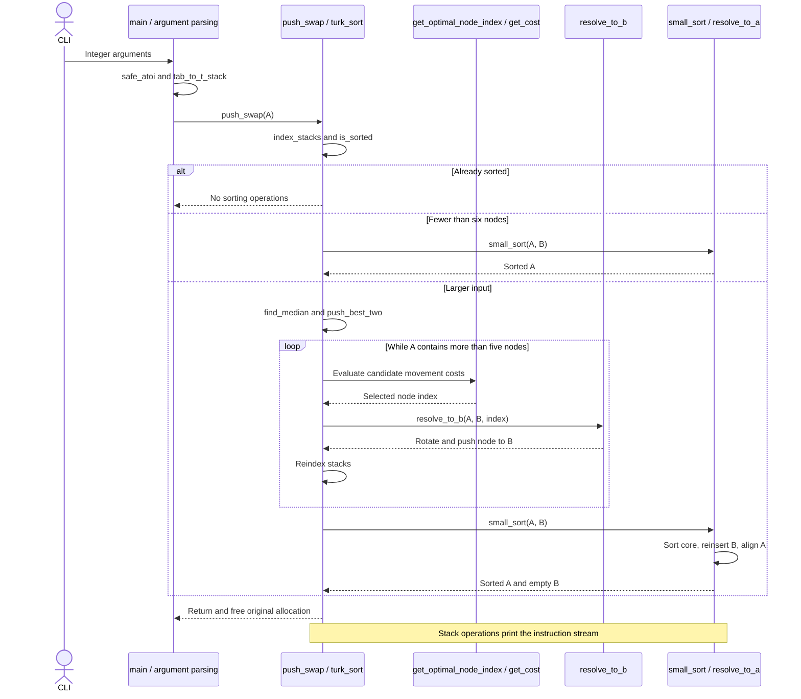

# mypushswap: UML

Reviewed source: [375f3f905e77](https://github.com/ErwanLucienMMV/mypushswap/tree/375f3f905e772faa25a7358eb89d249c61e7c25d).

UML sequence of the implemented C sorting functions. Lifelines name functions, not classes. Stacks A and B are linked t_stack nodes containing num, index and next. turk_sort skips already sorted inputs, uses small_sort for fewer than six nodes, and otherwise transfers chosen nodes to B before sorting/reinserting. Operation wrappers emit the restricted push/swap/rotation instruction stream. This is a structural code review, not a proof of optimal instruction count.

[Open SVG](../../../backend/src/content/diagrams/mypushswap.svg).
Portfolio: `/fr/projets?project=mypushswap` and `/en/projects?project=mypushswap`.
API: `/api/diagrams/mypushswap.svg`.

Inspected implementation files:

- [push_swap.h](https://github.com/ErwanLucienMMV/mypushswap/blob/375f3f905e772faa25a7358eb89d249c61e7c25d/push_swap.h)
- [main.c](https://github.com/ErwanLucienMMV/mypushswap/blob/375f3f905e772faa25a7358eb89d249c61e7c25d/main.c)
- [push_swap.c](https://github.com/ErwanLucienMMV/mypushswap/blob/375f3f905e772faa25a7358eb89d249c61e7c25d/push_swap.c)
- [turk_sort.c](https://github.com/ErwanLucienMMV/mypushswap/blob/375f3f905e772faa25a7358eb89d249c61e7c25d/turk_sort.c)
- [get_cost.c](https://github.com/ErwanLucienMMV/mypushswap/blob/375f3f905e772faa25a7358eb89d249c61e7c25d/get_cost.c)
- [resolve_to.c](https://github.com/ErwanLucienMMV/mypushswap/blob/375f3f905e772faa25a7358eb89d249c61e7c25d/resolve_to.c)
- [resolve_helper.c](https://github.com/ErwanLucienMMV/mypushswap/blob/375f3f905e772faa25a7358eb89d249c61e7c25d/resolve_helper.c)
- [turk_sort_helpers.c](https://github.com/ErwanLucienMMV/mypushswap/blob/375f3f905e772faa25a7358eb89d249c61e7c25d/turk_sort_helpers.c)
