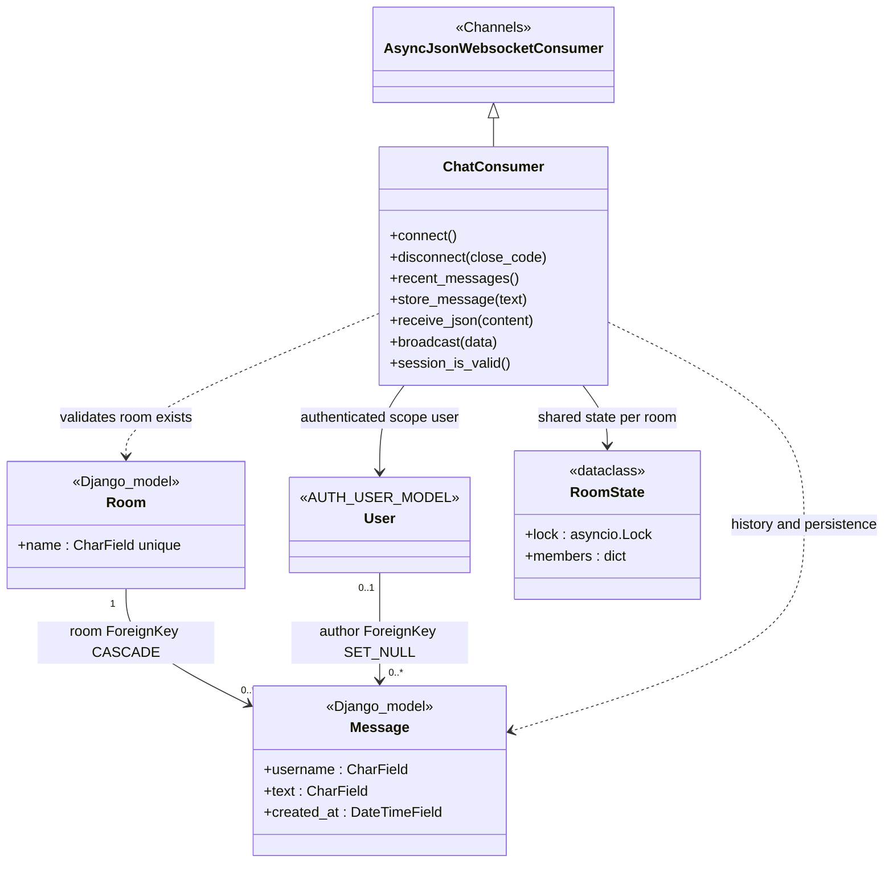

# Piscine-Django-42: UML

Reviewed source: [76cbffb779c3](https://github.com/ErwanLucienMMV/Piscine-Django-42/tree/76cbffb779c36b96bcca0405b806f1c0c418a667).

This is a collection of independent exercises, not one deployed application. The UML focuses on the implemented final d09 chat exercise. Its actual settings use SQLite and an in-memory Channels layer, with room presence local to one ASGI process. Room and Message are Django models; RoomState is a process-local dataclass. Authentication middleware supplies the user, sessions are rechecked for long-lived sockets, and history is persisted. Earlier SQL/ORM/article exercises are outside this focused view.

[Open SVG](../../../backend/src/content/diagrams/piscine-django-42.svg).
Portfolio: `/fr/projets?project=piscine-django-42` and `/en/projects?project=piscine-django-42`.
API: `/api/diagrams/piscine-django-42.svg`.

Inspected implementation files:

- [Django 3 Final/d09/chat/models.py](https://github.com/ErwanLucienMMV/Piscine-Django-42/blob/76cbffb779c36b96bcca0405b806f1c0c418a667/Django%203%20Final/d09/chat/models.py)
- [Django 3 Final/d09/chat/consumers.py](https://github.com/ErwanLucienMMV/Piscine-Django-42/blob/76cbffb779c36b96bcca0405b806f1c0c418a667/Django%203%20Final/d09/chat/consumers.py)
- [Django 3 Final/d09/chat/views.py](https://github.com/ErwanLucienMMV/Piscine-Django-42/blob/76cbffb779c36b96bcca0405b806f1c0c418a667/Django%203%20Final/d09/chat/views.py)
- [Django 3 Final/d09/chat/routing.py](https://github.com/ErwanLucienMMV/Piscine-Django-42/blob/76cbffb779c36b96bcca0405b806f1c0c418a667/Django%203%20Final/d09/chat/routing.py)
- [Django 3 Final/d09/d09/asgi.py](https://github.com/ErwanLucienMMV/Piscine-Django-42/blob/76cbffb779c36b96bcca0405b806f1c0c418a667/Django%203%20Final/d09/d09/asgi.py)
- [Django 3 Final/d09/d09/settings.py](https://github.com/ErwanLucienMMV/Piscine-Django-42/blob/76cbffb779c36b96bcca0405b806f1c0c418a667/Django%203%20Final/d09/d09/settings.py)
- [Django 3 Final/d09/account/views.py](https://github.com/ErwanLucienMMV/Piscine-Django-42/blob/76cbffb779c36b96bcca0405b806f1c0c418a667/Django%203%20Final/d09/account/views.py)
